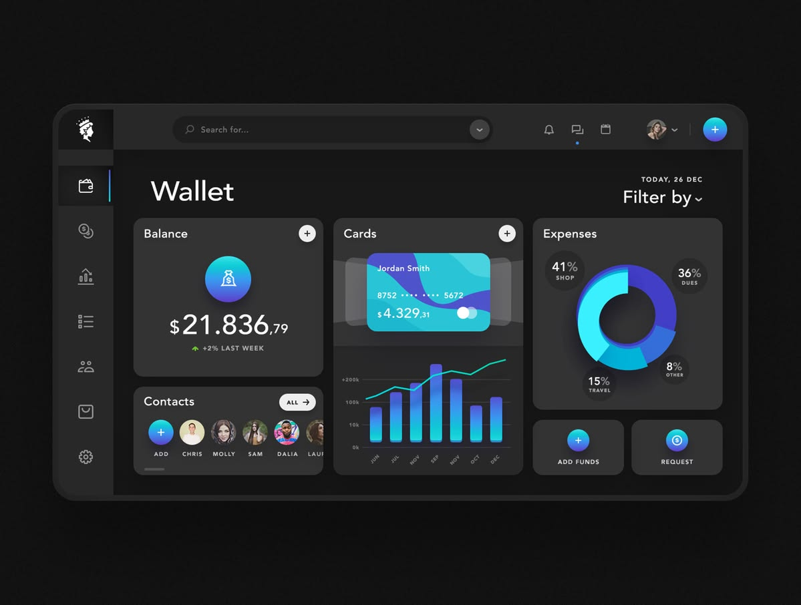
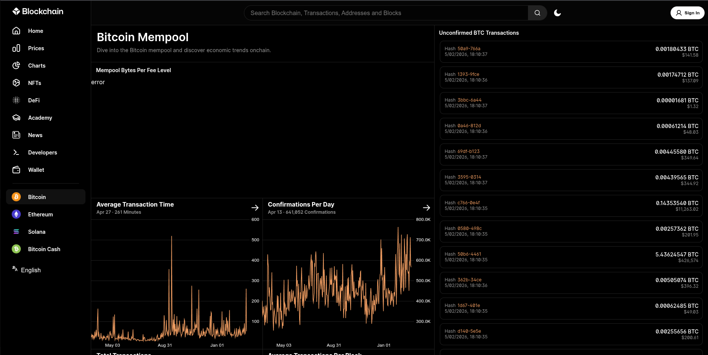
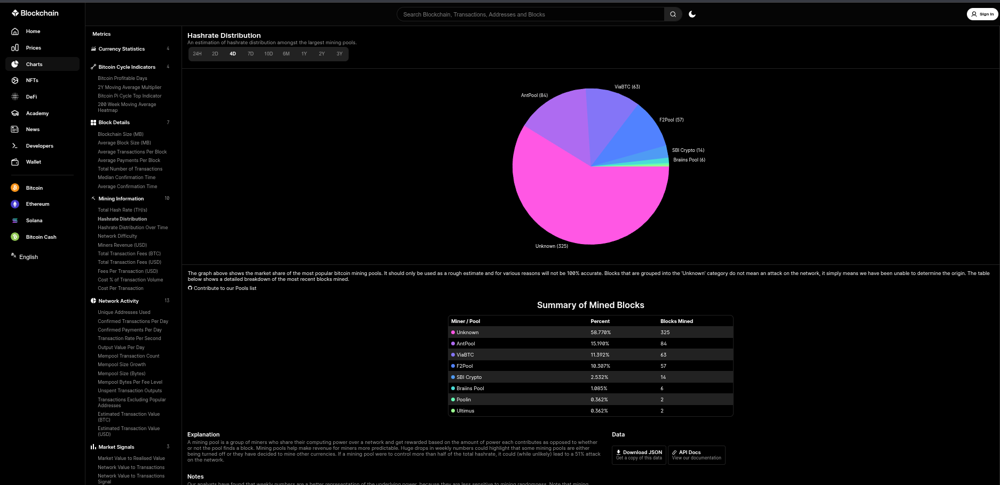

# 🇹🇿 Tancoin (TAN) — Tanzania Digital Coin

[](https://www.python.org/)
[](https://www.djangoproject.com/)
[](LICENSE)
[](#architecture)

> **Tancoin (TAN)** is a decentralized cryptocurrency and UTXO blockchain implementation written in pure Python with a full-stack Django node and web interface. It combines the proven cryptographic security of **Bitcoin** (Proof of Work, UTXO, secp256k1, Base58Check) with smart contract capabilities inspired by **Ethereum** via the **Tancoin Virtual Machine (TVM)**.

---

## 📸 System Previews

| Wallet Interface | Blockchain Explorer |
| :---: | :---: |
|  |  |

| Mempool Monitor | Mining & Hashrate Distribution |
| :---: | :---: |
|  |  |

---

## ⚡ Core Blockchain Specifications

| Metric | Specification |
| :--- | :--- |
| **Coin Name** | Tancoin (Tanzania Digital Coin) |
| **Ticker Symbol** | **TAN** |
| **Decimals** | **8** ($1\text{ TAN} = 100,000,000\text{ satoshis}$) |
| **Max Supply** | **21,000,000 TAN** |
| **Block Reward** | **50 TAN** per mined block |
| **Consensus Algorithm** | **Proof-of-Work (PoW)** via double SHA-256 (`sha256d`) |
| **Signature Algorithm** | **ECDSA on secp256k1** (same as Bitcoin & Ethereum) |
| **Address Format** | **Base58Check P2PKH** (prefixed with `1`) |
| **Smart Contract Engine**| **TVM** (Tancoin Virtual Machine with deterministic stack & gas) |

---

## 🚀 Quick Start (Local Development)

### 1. Clone & Set Up Virtual Environment
```bash
git clone https://github.com/Hemedi18/tandigitalcoin.git
cd tandigitalcoin

# Create and activate virtual environment
python3 -m venv .venv
source .venv/bin/activate  # On Windows: .venv\Scripts\activate

# Install dependencies
pip install -r requirements.txt
```

### 2. Run Database Migrations
```bash
python manage.py migrate
```

### 3. Start the Node Server
```bash
python manage.py runserver
```
Visit **`http://127.0.0.1:8000/`** in your browser to access:
- **Blockchain Explorer**: `http://127.0.0.1:8000/`
- **Interactive Web Wallet**: `http://127.0.0.1:8000/wallet/`
- **Documentation Hub**: `http://127.0.0.1:8000/docs/`
- **Mempool Viewer**: `http://127.0.0.1:8000/mempool/`
- **Hashrate & Block Charts**: `http://127.0.0.1:8000/charts/`

---

## 🌐 Deploying to cPanel

This project is pre-configured for direct cPanel hosting (Phusion Passenger / CloudLinux):
- Includes `passenger_wsgi.py` and production `.htaccess`.
- Complete step-by-step instructions: see **[CPANEL_DEPLOYMENT_GUIDE.md](CPANEL_DEPLOYMENT_GUIDE.md)**.

---

## 📚 Documentation & Guides

- **[Beginner's Guide (ELI5)](docs/BEGINNER_GUIDE.md)**: Real-time everyday examples with TAN Coin (coffee in Dar es Salaam, Kariakoo trade, family remittances).
- **[Developer API Reference](docs/API.md)**: Complete REST JSON API documentation.
- **[Developer Integration](docs/INTEGRATION.md)**: Integrating Tancoin into external services, exchanges, and POS systems.
- **[Smart Contracts (TVM)](docs/SMART_CONTRACTS.md)**: Bytecode specifications, opcodes, and contract deployment.

---

## 📄 License
This project is open-source and licensed under the [MIT License](LICENSE).
