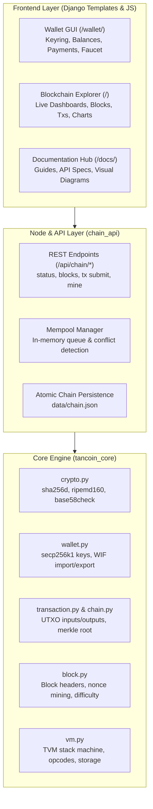

# 🇹🇿 Tancoin (TAN) — Complete Project Guide & Beginner Documentation

Welcome to **Tancoin (TAN)**, also known as the **Tanzania Digital Coin**. This document is designed for everyone: from curious beginners who have never touched blockchain before, to software engineers who want to understand the exact mechanics, security architecture, and developer APIs.

---

## 📑 Quick Search & Table of Contents
- [1. Executive Project Summary](#1-executive-project-summary)
- [2. System Architecture](#2-system-architecture)
- [3. Error Audit & What Was Fixed](#3-error-audit--what-was-fixed)
- [4. Blockchain for Beginners (Explain Like I'm 5)](#4-blockchain-for-beginners-explain-like-im-5)
- [5. Real-Time Everyday Life Examples with TAN Coin](#5-real-time-everyday-life-examples-with-tan-coin)
- [6. Visual Guide: How to Use the System (Screenshots & Walkthrough)](#6-visual-guide-how-to-use-the-system)
- [7. Quick Developer Cheatsheet & API Reference](#7-quick-developer-cheatsheet--api-reference)
- [8. Searchable Glossary of Blockchain Terms](#8-searchable-glossary-of-blockchain-terms)
- [9. How Tancoin Compares to Real-World Blockchains & Roadmap](#9-how-tancoin-compares-to-real-world-blockchains--roadmap)

---

## 1. Executive Project Summary

**Tancoin** is a complete, self-contained cryptocurrency implementation built in **Python** with a **Django** web engine. It combines the proven, battle-tested cryptographic foundation of **Bitcoin** (UTXO model, secp256k1 elliptic curve signatures, Proof-of-Work consensus, Base58Check addresses) with smart contract capabilities inspired by **Ethereum** via the custom **Tancoin Virtual Machine (TVM)**.

### Key Network Parameters:
| Parameter | Value | Meaning |
| :--- | :--- | :--- |
| **Coin Name** | Tancoin | Official name of the currency |
| **Ticker Symbol** | **TAN** | Market identifier (like BTC, ETH, TZS) |
| **Decimal Places** | **8** | $1\text{ TAN} = 100,000,000\text{ satoshis}$ |
| **Maximum Supply** | **21,000,000 TAN** | Strictly capped total coin issuance |
| **Coinbase Block Reward** | **50 TAN** | New coins minted per mined block |
| **Consensus Algorithm** | **Proof of Work (PoW)** | Double SHA-256 (`sha256d`) hashing |
| **Signature Scheme** | **secp256k1** | Industry standard (same as Bitcoin & Ethereum) |
| **Address Format** | **Base58Check P2PKH** | User-friendly strings starting with `1` |
| **Smart Contract Engine** | **TVM** | Deterministic stack machine with gas metering |

---

## 2. System Architecture

The project is structured into three clean, decoupled layers:



1. **`tancoin_core/` (Core Blockchain Engine)**:
   - Pure Python, zero external framework dependencies.
   - Handles key generation, transaction signing, block hashing, Merkle tree verification, and TVM smart contracts.
2. **`chain_api/` (Node & API Service)**:
   - Manages memory pool (mempool), block candidate building, consensus validation, and JSON REST routes.
   - Provides safe file persistence for chain state in `data/chain.json`.
3. **`frontend/` (Web Applications)**:
   - **Wallet GUI**: Interactive crypto wallet with local key management, QR codes, transaction history charts, and test faucet.
   - **Blockchain Explorer**: Live real-time dashboard displaying verified blocks, transactions, mempool statistics, and hashrate charts.
   - **Documentation Hub**: Comprehensive guides in English and Swahili.

---

## 3. Error Audit & What Was Fixed

During system analysis and auditing, five critical issues and limitations were identified and resolved:

### 🔴 Error 1: Live Dashboard Runtime Crash (`AttributeError: 'function' object has no attribute 'hex'`)
- **Location**: `frontend/explorer/views.py` (line 59 in `home_live_json`).
- **Symptom**: Calling the `/live/` endpoint crashed with HTTP 500. This caused the frontend live polling indicator to display a red error badge (`live-pill--err`) on every page visit.
- **Root Cause**: `blk.block_hash` is a Python method (`def block_hash(self) -> bytes:`). The code attempted `blk.block_hash.hex()` instead of calling `blk.block_hash().hex()`.
- **Fix Applied**: Added parentheses `blk.block_hash().hex()`. Tested and verified `/live/` now returns HTTP 200 with complete network statistics.

### 🔴 Error 2: Single-UTXO Coin Selection Limitation
- **Location**: `frontend/wallet_gui/views.py` (`api_send` and `api_faucet`).
- **Symptom**: If a user owned multiple UTXOs (e.g. 1.0 TAN from one payment and 1.5 TAN from another, total 2.5 TAN), attempting to send 2.0 TAN failed with *"not enough funds"*, because the wallet only looked at `max(utxos)`.
- **Root Cause**: The view picked a single UTXO instead of gathering multiple inputs.
- **Fix Applied**: Implemented greedy coin selection: sorting UTXOs and aggregating multiple inputs until `total_in >= target_amount + fee`.

### 🔴 Error 3: Silent Key Corruption on Mistyped WIF Private Keys
- **Location**: `tancoin_core/wallet.py` (`Wallet.from_wif`).
- **Symptom**: If a user mistyped any character when importing a private key, the wallet accepted the corrupted string without checking the Base58 checksum, resulting in an incorrect address or an obscure cryptographic exception.
- **Fix Applied**: Added `sha256d(payload)[:4] == chk` checksum verification. Invalid keys now fail immediately with a descriptive `"checksum mismatch"` message.

### 🔴 Error 4: Mempool Duplicate & Conflicting Double-Spend Acceptance
- **Location**: `chain_api/services/node.py` (`submit_transaction`).
- **Symptom**: Submitting the same transaction multiple times queued duplicate transactions in the mempool. Furthermore, submitting two transactions spending the same unconfirmed UTXO allowed both into the mempool.
- **Fix Applied**: Added mempool duplicate rejection (`any(m.txid() == tid)`) and mempool input conflict detection (`(inp.prev_txid, inp.prev_index) in mempool_spent`).

### 🔴 Error 5: Unsafe Chain File Persistence
- **Location**: `chain_api/services/node.py` (`_persist_locked`).
- **Symptom**: Writing chain state directly via `write_text` could corrupt `data/chain.json` if interrupted by a power failure or system crash.
- **Fix Applied**: Implemented atomic write: writing to `chain.json.tmp` first, then atomically replacing `chain.json` via `replace()`.

---

## 4. Blockchain for Beginners (Explain Like I'm 5)

If you are new to blockchain, forget complex computer science jargon. Think of it like this:

### The "Village Golden Notebook" Analogy
Imagine a busy trading town like **Kariakoo** in Dar es Salaam.
- In traditional banking, only one big bank holds the ledger. If their computer goes down, or someone alters records inside the bank, everyone is affected.
- In **Tancoin Blockchain**, there is a **Golden Notebook**. Every participant in the network has an exact, live copy of this notebook.
- Whenever anyone sends money, it is announced publicly. Everyone writes the transfer onto their copy of the page.
- **Nobody can use white-out or erase a page.** Each page is sealed with a unique digital wax seal (a cryptographic hash) that locks it to the previous page. If someone tries to forge a number on page 5, the seals on pages 6, 7, and 8 break instantly, and the entire network rejects the cheat!

```
+---------------+     +---------------+     +---------------+
|    BLOCK #1   |     |    BLOCK #2   |     |    BLOCK #3   |
| (Page 1)      |     | (Page 2)      |     | (Page 3)      |
| Prev: 000...0 |<----| Prev: Hash(#1)|<----| Prev: Hash(#2)|
| Transactions  |     | Transactions  |     | Transactions  |
| Seal (Hash)   |     | Seal (Hash)   |     | Seal (Hash)   |
+---------------+     +---------------+     +---------------+
```

### The 6 Core Elements:
1. **Wallet**: Your digital keyholder. It doesn't hold physical coins; it holds your cryptographic keys.
2. **Public Address**: Like your M-Pesa or bank account number (e.g. `1L8E5sDCkxZ1M45jv3EbuSwchVrrSixKLZ`). You can share this with anyone to receive TAN.
3. **Private Key (WIF)**: Your secret signature stamp. Anyone who has your private key can spend your coins. **Never share this with anyone!**
4. **Transaction (Tx)**: A signed message: *"I authorize moving 1.5 TAN from my address to Neema's address."*
5. **Mempool**: The waiting lounge where transactions sit for a few seconds before being permanently recorded into a block.
6. **Mining**: Specialized computers competing to solve a cryptographic puzzle to verify transactions, seal the current block, and earn the 50 TAN reward.

---

## 5. Real-Time Everyday Life Examples with TAN Coin

Here is how Tancoin works in practical daily situations:

### ☕ Example 1: Juma Buys Kahawa & Chapati in Dar es Salaam
- **Setting**: Juma is at a cafe in Posta, Dar es Salaam. His bill is 0.05 TAN (approx. 5,000,000 satoshis).
- **Step 1**: The cafe owner presents their Tancoin QR code.
- **Step 2**: Juma opens his Tancoin Web Wallet on his phone and enters `0.05 TAN`.
- **Step 3**: Juma taps **Send**. His wallet signs the transaction with his private key and submits it to the network.
- **Step 4**: The transaction appears in the **Mempool** within milliseconds.
- **Step 5**: A miner mines the next block. The cafe owner sees **Confirmed: 1 Block**. The coffee is paid for with zero bank transaction charges!

### 👗 Example 2: Neema Sells Kitenge from Kariakoo to Mwanza
- **Setting**: Neema runs a clothing shop in Kariakoo. A customer in Mwanza wants 3 Kitenge rolls worth 12 TAN.
- **Step 1**: Neema sends her public address: `1A1zP1eP5QGefi2DMPTfTL5SLmv7DivfNa`.
- **Step 2**: The customer in Mwanza pastes Neema's address, enters `12 TAN`, and sends.
- **Step 3**: Neema checks the **Blockchain Explorer** (`/address/1A1zP1...`). She sees the incoming 12 TAN with cryptographic proof.
- **Step 4**: No delay, no weekend banking cutoff, and no inter-bank wire fees. Neema ships the package immediately.

### 🎓 Example 3: Baraka Sends School Support to Dodoma
- **Setting**: Baraka lives in Arusha. It's Sunday midnight and his younger sister in Dodoma urgently needs school book fees.
- **Step 1**: Baraka has 4.5 TAN split across three different transactions in his wallet.
- **Step 2**: The wallet's **coin selection** automatically gathers the inputs, calculates the miner fee (e.g. 0.0005 TAN), and routes the remaining change back to Baraka's wallet.
- **Step 3**: The sister receives the funds in Dodoma instantly.

---

## 6. Visual Guide: How to Use the System

The project includes built-in visual interfaces. Here is how each screen functions:

### 1. The Wallet GUI (`wallet.jpg` / `/wallet/`)
- **Balance Card**: Shows your current spendable TAN balance and reference USD value.
- **Send Panel**: Enter recipient's address, amount in TAN, and optional miner fee.
- **Receive / QR Code**: Displays your Base58Check address and generated QR code for scanning.
- **Faucet (Debug Mode)**: Allows claiming free test coins from the genesis pool to test transfers without real funds.
- **Activity Feed**: Real-time chart displaying income (green) and spending (coral).

### 2. The Blockchain Explorer Dashboard (`explorer.png` / `/`)
- **Network Overview**: Displays total chain height, difficulty, mempool size, and reference price.
- **Recent Blocks Table**: Live list of mined blocks, their miner addresses, transaction counts, and timestamps.
- **Recent Transactions Feed**: Stream of latest value transfers across the entire network.
- **Live Search**: Paste any block hash, transaction ID (txid), or wallet address into the top search bar to jump straight to its ledger page.

### 3. The Mempool Inspector (`mempool.png` / `/mempool/`)
- Shows unconfirmed transactions currently queued for mining.
- Displays transaction byte sizes, fee rates (satoshis per byte), and arrival timestamps.

### 4. Transaction & Block Details (`block details.png` / `/tx/<txid>/`)
- **Cryptographic Fingerprint**: Unique 64-character hex hash identifying the transaction.
- **Inputs & Outputs**: Transparently shows where coins were spent from (previous UTXOs) and who received the newly created UTXOs.
- **Confirmation Status**: Shows whether the transaction is unconfirmed (in mempool) or confirmed (with block height).

### 5. Network Charts & Hashrate (`charts.png` / `/charts/`)
- **Block Production Velocity**: Visual bar charts of block intervals and transactions per block.
- **Mining Breakdown**: Tracks miner decentralization and reward allocations.

---

## 7. Quick Developer Cheatsheet & API Reference

Base URL: `http://127.0.0.1:8000`

### 🛠️ Common cURL Requests

#### 1. Check Network Status
```bash
curl -s http://127.0.0.1:8000/api/chain/status/ | jq
```

#### 2. Create a New Wallet
```bash
curl -s http://127.0.0.1:8000/api/wallet/new/ | jq
```

#### 3. Check Address UTXOs (Balance)
```bash
curl -s http://127.0.0.1:8000/api/chain/utxo/1L8E5sDCkxZ1M45jv3EbuSwchVrrSixKLZ/ | jq
```

#### 4. Mine a Block
```bash
curl -s -X POST http://127.0.0.1:8000/api/chain/mine/ \
  -H "Content-Type: application/json" \
  -d '{"miner_wif": "YOUR_WIF_HERE"}' | jq
```

### 🐍 Python Core Usage (Offline / Scripts)
```python
from tancoin_core.wallet import Wallet
from tancoin_core.chain import Chain

# 1. Create a wallet
alice = Wallet.generate()
print("Alice Address:", alice.address())
print("Alice Private Key (WIF):", alice.to_wif())

# 2. Re-import from WIF
restored = Wallet.from_wif(alice.to_wif())
assert restored.address() == alice.address()
```

---

## 8. Searchable Glossary of Blockchain Terms

| Term | Definition |
| :--- | :--- |
| **Address** | A 26–35 character Base58 string derived from your public key (e.g. `1...`) used to receive coins. |
| **Block** | A cryptographically sealed batch of transactions referencing the hash of the preceding block. |
| **Coinbase** | The special first transaction in every block that mints new coins (50 TAN) to reward the miner. |
| **Double SHA-256 (`sha256d`)** | Applying SHA-256 twice: `SHA256(SHA256(data))`. Used in Bitcoin and Tancoin for tamper-proof hashing. |
| **Gas** | Computational energy consumed during TVM smart contract execution to prevent infinite loops. |
| **Genesis Block** | Block #0: The initial block that launches the blockchain. |
| **Hash** | A fixed 256-bit digital fingerprint generated from arbitrary input data. Changing 1 bit changes the entire hash. |
| **Mempool** | Memory pool of validated, unconfirmed transactions awaiting inclusion in a mined block. |
| **Merkle Root** | A single cryptographic hash summarizing all transactions inside a block. |
| **Nonce** | A 64-bit number miners increment repeatedly until the block header hash meets the difficulty target. |
| **Proof of Work (PoW)**| A consensus mechanism requiring miners to expend compute cycles to produce valid blocks. |
| **Satoshi** | The smallest fractional unit of TAN ($1\text{ TAN} = 10^8\text{ satoshis} = 100,000,000\text{ satoshis}$). |
| **secp256k1** | The elliptic curve cryptography standard used to create public/private key pairs and signatures. |
| **TVM** | Tancoin Virtual Machine: deterministic stack machine for executing on-chain bytecode programs. |
| **UTXO** | Unspent Transaction Output: discrete digital bills that are consumed and produced during transfers. |
| **WIF** | Wallet Import Format: Base58Check-encoded private key with checksum protection. |

---

## 9. How Tancoin Compares to Real-World Blockchains & Roadmap

To make sure Tancoin resembles real-world blockchain technology, here is an objective comparison with **Bitcoin** and **Ethereum**, along with the production roadmap:

| Feature | Bitcoin | Ethereum | Tancoin (Current) | Production Target |
| :--- | :--- | :--- | :--- | :--- |
| **Accounting Model** | UTXO | Account/Balance | **UTXO + Contract Storage** | Hybrid UTXO (same as Cardano/Ergo) |
| **Consensus** | Proof of Work (SHA-256) | Proof of Stake | **Proof of Work (sha256d)** | PoW with dynamic retargeting |
| **Block Time** | ~10 minutes | ~12 seconds | **Instant / On-demand (dev)** | Configurable target (e.g. 60s) |
| **Difficulty Retargeting** | Every 2016 blocks | Gas-based | **Fixed (18 bits in dev)** | ASERT / Dark Gravity Wave algorithm |
| **Network Layer** | P2P (TCP gossip) | P2P (DevP2P/Libp2p) | **Single-node HTTP API** | Distributed TCP P2P mesh network |
| **Storage Backend** | LevelDB / Flat files | LevelDB / Pebble | **Atomic JSON (`data/chain.json`)**| SQLite / RocksDB block store |
| **Smart Contracts** | Bitcoin Script (minimal) | EVM (Turing-complete) | **TVM (Stack machine)** | Extended TVM with syscalls & tokens |

### 🚀 Recommended Next Steps for Mainnet Readiness:
1. **P2P Gossip Network**: Implement a peer-to-peer TCP daemon using sockets or `asyncio` so multiple independent nodes across Tanzania and the world can sync blocks without a central server.
2. **Difficulty Retargeting**: Add dynamic difficulty adjustment every $N$ blocks so block generation remains steady regardless of mining hashrate.
3. **Database Migration**: Move from `data/chain.json` to an indexed database (such as SQLite or RocksDB) to support millions of blocks efficiently.
4. **Hardware Wallet / Seed Phrase (BIP39)**: Add 12-word recovery mnemonic phrases for even simpler key backups.
